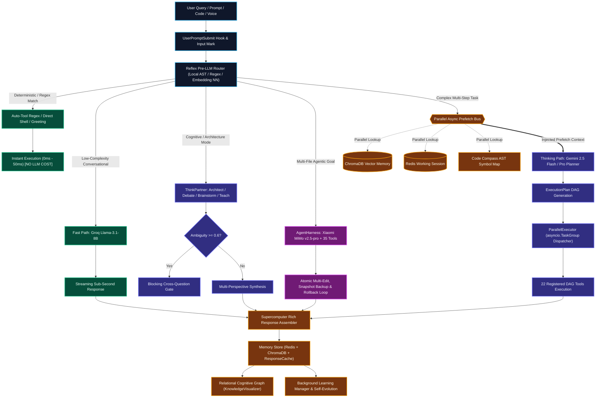
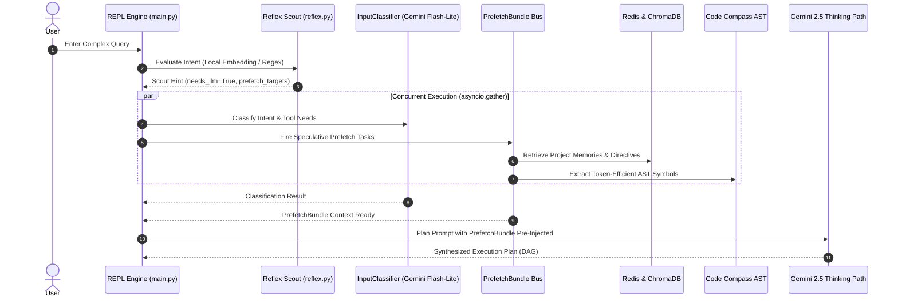
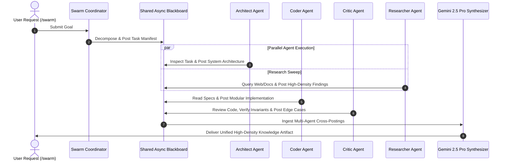

# ⚡ APEX // Sovereign Agentic AI OS

<p align="center">
  
</p>

<p align="center">
  <a href="#-system-architecture--visualizations"></a>
  <a href="#-the-reflex-engine--smart-routing"></a>
  <a href="#-multi-model-brain-matrix"></a>
  <a href="#-verification--test-suite"></a>
  <a href="./docs/EVALUATIONS.md"></a>
  <a href="#-web-dashboard--landing-hud"></a>
  
</p>

---

## 🌌 Executive Overview

**APEX** is a next-generation personal artificial intelligence operating system engineered for **cognitive supremacy, local sovereignty, speculative prefetching, multi-agent swarms, and self-evolving capability loops**. 

Unlike conventional chatbot wrappers or linear script dispatchers, APEX operates on a **24-layer recursive intelligence fabric**. It layers smart routing under a strict **"Fast Path Always Wins"** law: simple commands execute deterministically in single-digit milliseconds via local AST indices and regex tables, while ambiguous, high-entropy goals dynamically engage multi-model DAG planners, speculative prefetch buses, and sandboxed autonomous agent loops.

---

## 🏛️ System Architecture & Visualizations

### 1. Sovereign Omega System Architecture (Primary Blueprint)

APEX bridges deep strategic cognition, dual-tiered persistent memory, isolated sandboxed execution, and real-time sensory hardware context.

<p align="center">
  
</p>

---

### 2. Full End-to-End AI System Pipeline

The data-flow pipeline below illustrates how raw user input across text, voice, code, and vision traverses input preprocessing, vector memory retrieval, orchestration, model execution, tool calling, and self-improvement:

<p align="center">
  
</p>

---

### 3. Interactive Pipeline Flow: Fast-Path Routing & Concurrency

The APEX execution lifecycle routes requests through the cheapest, fastest viable layer before escalating to heavier neural tiers:



---

### 4. Speculative Prefetch Sequence (Zero-Latency Context Injection)

Rather than executing memory retrieval and intent classification serially, APEX uses `src/core/reflex.py` to trigger speculative prefetching in parallel with model classification:



---

### 5. Multi-Agent Swarm (Blackboard Collaboration Model)

For open-ended research, code generation, and competitive analysis, APEX deploys a coordinated multi-agent swarm over an asynchronous shared blackboard (`src/services/swarm.py`):



---

### 6. KnowledgeForge & Continuous Self-Evolution Lifecycle

APEX autonomously updates its own capabilities by scanning scientific literature, monitoring package ecosystems, testing code changes in temporary sandboxes, and verifying that performance never regresses:

```mermaid
flowchart LR
    classDef input fill:#1E293B,stroke:#38BDF8,stroke-width:1.5px,color:#F8FAFC;
    classDef process fill:#312E81,stroke:#818CF8,stroke-width:1.5px,color:#EEF2FF;
    classDef test fill:#78350F,stroke:#F59E0B,stroke-width:1.5px,color:#FFFBEB;
    classDef pass fill:#064E3B,stroke:#10B981,stroke-width:1.5px,color:#ECFDF5;
    classDef fail fill:#881337,stroke:#F43F5E,stroke-width:1.5px,color:#FFF1F2;

    Arxiv["Daily ArXiv Papers"]:::input --> PaperReader["PaperReader (Gemini Scoring)"]:::process
    Feeds["PyPI / GitHub / HN Feeds"]:::input --> EcoWatcher["EcosystemWatcher (Dedup)"]:::process

    PaperReader --> ChromaPapers[("ChromaDB: apex_forge_papers")]:::process
    EcoWatcher --> ChromaPapers

    ChromaPapers --> CapSynth["Capability Synthesizer"]:::process
    CapSynth --> Proposals[("proposals.json Queue")]:::process

    Proposals --> Applier["ProposalApplier (AST Code Gen)"]:::process
    Applier --> PipSandbox["PipSandbox (Temp Isolated venv)"]:::test
    PipSandbox --> BenchGate{"HumanEval-Lite Benchmark Gate"}:::test

    BenchGate -->|Pass Rate Maintained / Improved| ApplyCommit["Apply Changes to Main Repo + Snapshot Backup"]:::pass
    BenchGate -->|Regression Detected >= 15%| Rollback["Automatic Rollback to Snapshot"]:::fail
```



---

## 🧬 The 24-Layer Sovereign Stack

The APEX engine is divided into 4 sovereign tiers comprising 24 interconnected, fail-safe layers:

| Tier | Layer # | Layer Name | Technology / Service | Core Responsibility |
|:---|:---:|:---|:---|:---|
| **Tier 1: Strategic Cognition (The Brain)** | **L1** | **Intent Normalization & Reflex Routing** | `src/core/reflex.py`, `src/routers/router.py` | Local embedding NN & regex matching; bypasses paid LLMs for deterministic queries; triggers speculative prefetching. |
| | **L3** | **Master Orchestrator & DAG Synthesis** | `src/models/thinking_path.py` | Gemini 2.5 Flash / Pro; decomposes open-ended goals into dependency-ordered Directed Acyclic Graphs. |
| | **L14** | **Socratic Reasoning Gate** | `src/services/think_partner.py` | Probes unstated assumptions and introduces constructive friction before code or plans are executed. |
| | **L17** | **Proactive Strategic Collaborator** | `src/services/think_partner.py` | 6 interactive collaborative modes: Architect, Debate, Brainstorm, Teach, Cross-Question, and Intent Extraction. |
| | **L18** | **Steelman Reasoning Engine** | `src/services/genius_mode.py` | Generates the strongest opposing arguments to prevent bias and surface structural blind spots. |
| | **L22** | **Emotional Core & Cognitive Load** | `src/services/cognitive.py` | Analyzes user sentiment, typing velocity, and cognitive fatigue to dynamically calibrate APEX response depth. |
| **Tier 2: Sovereign Persistence (The Soul)** | **L2** | **Hybrid Memory Engine** | `src/services/memory.py` | Short-term working session in Redis combined with long-term semantic embeddings in ChromaDB. |
| | **L9** | **Summarize-Before-Drop Memory** | `src/services/memory.py` | When session history reaches `APEX_HISTORY_CAP`, compresses oldest turns into a structured summary to prevent context loss. |
| | **L10** | **Relational Cognitive Graph** | `src/services/cognitive_graph.py` | `KnowledgeVisualizer`; links interactions, decisions, and entities into a persistent graph (`.apex/knowledge_map.json`). |
| | **L12** | **Semantic Deduplication Cache** | `src/services/memory.py:ResponseCache` | Vector similarity lookup bypassing LLM inference for near-identical past prompts (sub-100ms response). |
| | **L13** | **AST Code Compass** | `src/services/code_compass.py` | Extracts symbol tables and AST maps into `.apex/code_compass.json`, yielding **8–20x token savings** during codebase analysis. |
| | **L24** | **Sovereign Workspace Isolation** | `src/tools/workspace.py` | Isolates project contexts, memories, and `.apex/` directives so multi-repo workflows never bleed together. |
| **Tier 3: High-Throughput Execution (The Muscle)** | **L4** | **Parallel TaskGroup Dispatcher** | `src/routers/router.py:ParallelExecutor` | Concurrent execution of DAG steps via Python `asyncio.TaskGroup` with hardware-aware resource gating. |
| | **L5B** | **Isolated Execution Sandbox** | `src/tools/sandbox.py`, `src/services/knowledge_forge/` | Timeout-limited execution environments for newly generated code and isolated pip venvs (`PipSandbox`). |
| | **L6** | **3-Tier Failover Recovery** | `src/routers/router.py`, `src/models/fallback_path.py` | Automatic 3-tier recovery cascade: Agent retry → Gemini primary retry → OpenRouter `gpt-oss-120b` / `ring-2.6-1t`. |
| | **L7** | **Multi-Stage Coding Pipeline** | `src/services/coding.py` | Stage 1: MiniMax 2.5 (Architecture Spec) → Stage 2: MiMo v2.5-pro (Implementation) → Stage 3: Gemini (Validation). |
| | **L8** | **Response Assembly Engine** | `src/services/delivery.py` | Rich synthesis engine formatting code diffs, telemetry cards, and multi-perspective intellectual outputs. |
| | **L10B** | **Multi-Agent Research Swarm** | `src/services/swarm.py` | Coordinator, Architect, Coder, Critic, Researcher, and Planner agents collaborating over an async blackboard. |
| | **L20** | **Continuous Self-Evolution Engine** | `src/services/self_evolution.py` | Idle-time background loop scanning repo AST for TODOs, complexity spikes, and approved Forge proposals. |
| | **L21** | **Autonomous AgentHarness** | `src/core/harness.py` | Independent 35-tool autonomous agent loop driven by Xiaomi MiMo v2.5-pro with atomic multi-file edits and rollback snapshots. |
| **Tier 4: Sensory, Hardware & Interface (The Senses)** | **L11** | **Hardware Monitor & Thermal Gating** | `src/tools/hardware.py` | Proactively tracks CPU, RAM, and GPU load; dynamically throttles concurrency if host vitals hit critical levels. |
| | **L15** | **Telemetry & Spend Analytics** | `src/core/telemetry.py` | Real-time USD cost calculation, token logging, and per-tool success/failure metrics stored in SQLite. |
| | **L16** | **Retina Multimodal Vision** | `src/tools/vision.py` | Screen capture, OCR, OpenCV frame-sampled video understanding, and Groq Whisper audio transcription. |
| | **L19** | **ANSI Half-Block Pixel Mascot** | `src/core/animations.py:ApexMascot` | Handcrafted 16x16 pixel mascot rendered via `▀`/`▄` half-block cells with 14 affective emotional states. |
| | **L23** | **Interaction Velocity & Flow Protection** | `src/services/cognitive.py` | Monitors prompt submission velocity to prevent thrashing and adjust response density to match user flow state. |

---

## 🧠 Multi-Model Brain Matrix

APEX does not rely on a single vendor or model. It dynamically matches tasks to specialized inference providers:

| Brain Provider | Default Model | Primary Role | Fallback Cascade |
|:---|:---|:---|:---|
| **Google Gemini** | `gemini-2.5-flash` / `gemini-2.5-pro` | DAG Master Planner, GeniusMode Critique, Vision/Multimodal, Forge Ingestion | Groq Llama-3.1-8B → OpenRouter `gpt-oss-120b` |
| **Xiaomi MiMo** | `mimo-v2.5-pro` (via OpenAI SDK) | Coding Pipeline Implementation (Stage 2), Autonomous AgentHarness primary brain | Groq Llama-3.1-8B |
| **Groq Cloud** | `llama-3.1-8b-instant` | Fast Path conversational chat, streaming summaries, low-complexity instant replies | Gemini 2.5 Flash Lite |
| **MiniMax** | `minimax-2.5` | Coding Pipeline Architecture Specs (Stage 1) | Gemini 2.5 Pro |
| **OpenRouter** | `inclusionai/ring-2.6-1t:free` | 1-Trillion Parameter deep reasoning for ThinkPartner & GeniusMode debate | Gemini 2.5 Pro |
| **OpenRouter** | `gpt-oss-120b` | Tertiary DAG planner failover when primary and secondary APIs exhaust | Graceful degradation stub |
| **Groq Whisper** | `whisper-large-v3` | Near-instant audio and voice transcription | Local faster-whisper fallback |

---

## 🛠️ Dual Tool Surfaces

APEX features **two complementary, independent tool surfaces**:

### 1. The 22 Registered DAG Tools (`src/tools/registry.py`)
Used by the Gemini DAG Planner for structured multi-step execution plans. Dynamically compiled into the model's system prompt without hardcoded drift.

| Tool Name | Aliases | Capabilities |
|:---|:---|:---|
| `filesystem` | `fs`, `file` | Read, write, delete, list, search, and glob source trees with ripgrep integration. |
| `shell` | `bash`, `sh`, `run` | Execute system shell commands, environment scripts, and test runners safely. |
| `git` | `vcs` | Autonomous version control: commit, status, diff, branch, push, pull, log. |
| `python_executor` | `python`, `py` | Write and execute Python scripts directly in a temporary sandbox. |
| `research_swarm` | `research`, `rs` | Multi-agent web, file, and code research swarm building dense knowledge artifacts. |
| `web_search` | `search`, `ws` | Live web search via Tavily, Brave, or DuckDuckGo with automatic fallback. |
| `web_fetch` | `fetch`, `url`, `wf` | Fetch live web pages, strip HTML boilerplate, and decode entities (1.5MB cap). |
| `workspace` | `ws2` | Multi-project scanning, repository summaries, and `.apex/directives.md` parsing. |
| `mcp` | `mcp_call` | Dynamic discovery and execution of external Model Context Protocol (MCP) servers. |
| `vision` | `retina` | Desktop screenshot capture, OCR text extraction, video inspection, audio transcription. |
| `hardware` | `hw`, `vitals` | Real-time CPU, RAM, and GPU load monitoring for concurrency gating. |
| `code_compass` | `compass` | Query token-efficient AST symbol index (`.apex/code_compass.json`). |
| `knowledge_forge` | `forge` | Search arXiv papers, inspect ecosystem updates, and manage capability proposals. |
| `swarm` | `agents` | Spawn and orchestrate multi-agent squads across the shared async blackboard. |
| `think_partner` | `think` | Activate interactive cognitive collaboration modes (Architect, Debate, etc.). |
| `todo` | `todos`, `tasks` | Persistent task lifecycle management (`add`, `list`, `update`, `remove`, `clear`). |
| `diff` | `compare`, `patch` | Unified line-by-line diffing between files or dynamic content buffers. |
| `desktop_control` | `desktop`, `dc` | OS-level window management, keyboard/mouse actions, and application control. |
| `codebase_index` | `cindex`, `symbols` | Symbol extraction, reference mapping, and semantic index over local source tree. |
| `weather` | `forecast`, `meteo` | Real-time weather, temperature, humidity, and forecast retrieval. |
| `api_connector` | `api`, `http`, `curl` | REST API client with URL whitelisting, timeout controls, and header injection. |
| `app_launcher` | `launch`, `open`, `app` | Multi-tier desktop application resolution (fuzzy, protocol URIs, PATH discovery). |

### 2. The 35 Autonomous AgentHarness Tools (`src/core/harness.py`)
Used by the autonomous agent loop (`/harness`) for open-ended multi-file refactoring and bug fixing:
- **Safety First**: OS-level blocklist locks down `.git/`, `.env`, `id_rsa`, and `.ssh/`.
- **Atomic Multi-Edit**: Validates all edits across files before applying; rolls back on any partial failure.
- **Automatic Snapshots**: Backs up all modified files to `backups/harness_<timestamp>/` with one-command rollback (`harness.rollback()`).

---

## 🎨 Terminal Identity & ANSI Pixel Mascot

APEX features a rich terminal interface powered by `src/core/animations.py`:

```
   ▄██████▄      [APEX // SOVEREIGN OMEGA]
  ███▀▀▀▀███     Mode: FOCUS // Engine: ONLINE
  ███ █  ███     Brains: Gemini 2.5 • MiMo v2.5-pro • Groq
  ███ █  ███     Memory: Redis (Hot) + ChromaDB (Semantic)
   ▀██████▀      Cost: $0.0000 USD // Latency: 42ms
```

- **14 Affective Mascot States**: `focus`, `coding`, `thinking`, `learning`, `building`, `analyzing`, `deploying`, `connected`, `happy`, `excited`, `focused`, `determined`, `curious`, and `proud`.
- **ANSI Half-Block Engine**: Handcrafted 16x16 pixel sprites rendered using `▀`/`▄` half-block cells and exact RGB hex codes (`(255, 215, 0)` gold eyes, `#141419` terminal screen, `#D7C6B2` chassis), completely eliminating blurry image downsampling.
- **Cinematic Boot Sequence**: Matrix rain sweep, pyfiglet color-pulse banner, thinking orb async spinner, and interactive checklist trails.

---

## 💻 Web Dashboard & Landing (HUD)

APEX includes a companion web dashboard located in the [`Landing`](./Landing) directory:
- **Design System**: High-contrast, Swiss Modernist / Armory aesthetic with 1px hairline borders (`#D9D9D9`) and electric accents (`#FF3700`).
- **Core Stack**: Next.js 14 (App Router), Tailwind CSS, Framer Motion, Lucide Icons.
- **Features**: Visual telemetry, interactive knowledge graph, proposal approval queue, and interactive command palette.
- **Launch**: Run `npm run dev` inside `./Landing` and open `http://localhost:3000`.

---

## ⚡ Quick Start & Setup

### 1. Prerequisites
- **Python 3.10+**
- **Redis Server** (optional but recommended for session persistence; automatically degrades gracefully if offline)
- **Node.js 18+** (for MCP servers and Web HUD)

### 2. Clone & Install Dependencies
```bash
git clone https://github.com/your-username/apex.git
cd apex
pip install -r requirements.txt
```

### 3. Environment Configuration
Create a `.env` file in the project root:
```env
# ── Primary Reasoning & Planning Brains ──────────────────────────────
GEMINI_API_KEY=your_gemini_api_key
GROQ_API_KEY=your_groq_api_key

# ── Autonomous Coding Brain (AgentHarness & Coding Pipeline) ─────────
MIMO_API_KEY=your_mimo_api_key

# ── Architecture Spec & Tertiary Fallbacks (Optional) ───────────────
MINIMAX_API_KEY=your_minimax_api_key
OPENROUTER_API_KEY=your_openrouter_api_key

# ── Live Web Search (Optional - Falls back to DDG if empty) ──────────
TAVILY_API_KEY=your_tavily_api_key
BRAVE_API_KEY=your_brave_api_key

# ── Memory & Persistence ─────────────────────────────────────────────
REDIS_HOST=localhost
REDIS_PORT=6379
CHROMA_PATH=./data/chroma

# ── Runtime Performance Flags ─────────────────────────────────────────
APEX_ECONOMY=1           # 1 = Max speed/cost efficiency; 0 = Full multi-agent reasoning
APEX_BG_LOOPS=0          # 1 = Enable background KnowledgeForge & SelfEvolution ticks
APEX_HISTORY_CAP=20      # Turns before summarize-before-drop engages
```

### 4. Launch APEX

**Interactive Terminal CLI:**
```bash
# Windows PowerShell (ensures UTF-8 unicode formatting for Rich UI):
$env:PYTHONIOENCODING="utf-8"; python main.py

# Linux / macOS:
python3 main.py
```

**Web HUD Dashboard:**
```bash
cd Landing
npm install
npm run dev
# Open http://localhost:3000
```

---

## ⌨️ Interactive Command Deck (Slash Commands)

APEX ships with an extensive suite of over 60 slash commands accessible from the REPL:

### Autonomous & Engineering
| Command | Description |
|:---|:---|
| `/harness <goal>` | Launch the autonomous MiMo-driven tool loop with atomic file edits and rollback snapshots. |
| `/analyze` | Build or update the token-efficient Code Compass AST symbol map (`.apex/code_compass.json`). |
| `/project <name>` | Switch active workspace context and reload project-isolated memories. |
| `/evolve` | Trigger an immediate self-improvement cycle scanning codebase AST for optimizations. |
| `/diff [file]` | Generate a unified color-coded diff between working files or staging buffers. |

### Cognitive & Collaborative Modes
| Command | Description |
|:---|:---|
| `/genius` | Toggle 5-stage multi-pass critique mode (hypothesis → counter → blind spots → synthesis). |
| `/think <mode>` | Launch ThinkPartner in one of 6 modes: `architect`, `debate`, `brainstorm`, `teach`, `cross_question`. |
| `/socratic` | Force assumption-probing questions before plan execution. |
| `/steelman` | Generate the strongest possible opposing arguments against your current hypothesis. |
| `/swarm <goal>` | Dispatch a specialized agent swarm (Architect, Coder, Critic, Researcher, Planner) over the blackboard. |

### Research, Tools & Media
| Command | Description |
|:---|:---|
| `/web <query>` | Trigger multi-agent deep research swarm aggregating live web search results. |
| `/fetch <url>` | Scrape and extract clean text from any URL with HTML boilerplate stripped. |
| `/todo` | View and manage the persistent task lifecycle list. |
| `/resume <pdf/docx>` | Ingest, parse, and rewrite a resume into ATS-optimized format using Gemini. |
| `/vision <file>` | Multimodal analysis: OCR, image inspection, video frame sampling, or audio transcription. |

### Telemetry, Flags & Controls
| Command | Description |
|:---|:---|
| `/status` | Display full system status: memory connections, active MCP servers, and model availability. |
| `/vitals` | Inspect real-time host CPU, RAM, GPU, and thermal health metrics. |
| `/reflex` | Display Reflex routing telemetry: cache hits, 0ms LLM skip rate, and source distribution. |
| `/tools` | Inspect per-tool success/failure counters and last recorded execution errors. |
| `/economy on\|off` | Toggle Economy mode (bypasses auxiliary cognitive passes to minimize spend). |
| `/autotool on\|off` | Toggle regex auto-selector for single-tool direct dispatch. |
| `/autothink on\|off` | Toggle automatic intent routing to ThinkPartner for ambiguous prompts. |
| `/clear` | Wipe session context or purge memory collections (`/clear all`). |

---

## 📁 Repository Layout & Persistence

```
realjarvis/
├── .apex/                          # Project-specific workspace metadata
│   ├── forge_state.json            # KnowledgeForge cycle history & summaries
│   ├── code_compass.json           # Token-efficient AST symbol index (5-12% size)
│   ├── hooks.json                  # Lifecycle hook configurations
│   └── knowledge_map.json          # Persistent Relational Cognitive Graph
├── data/
│   ├── chroma/                     # ChromaDB vector collections (memory, cache, papers)
│   ├── todos.json                  # Persistent task list storage
│   └── forge/                      # KnowledgeForge data pipeline
│       ├── papers.jsonl            # Ingested arXiv papers log
│       ├── ecosystem.jsonl         # PyPI / GitHub / HN ecosystem feed
│       ├── proposals.json          # Capability proposals queue
│       ├── bench.json              # Self-benchmark regression scores
│       ├── backups/<id>/<ts>/      # Pre-apply code snapshot backups
│       └── venvs/<id>/             # PipSandbox isolated testing environments
├── backups/                        # AgentHarness file snapshots & rollback targets
├── docs/                           # In-depth architectural & operational guides
│   ├── ARCHITECTURE.md             # Detailed 24-layer architectural breakdown
│   ├── COMMANDS.md                 # Full 60+ slash command documentation
│   ├── EVALUATIONS.md              # Empirical benchmark suite (Speed, Quality, Integrity, Retrieval)
│   ├── HARNESS.md                  # Autonomous agent harness guide
│   ├── MODELS.md                   # Multi-brain model selection rationale
│   ├── SETUP.md                    # Detailed environment setup & troubleshooting
│   ├── TESTING.md                  # Test suite architecture & mock patterns
│   ├── TOOLS.md                    # Complete 22 DAG + 35 Harness tool reference
│   └── VISION.md                   # Multimodal & Retina vision specifications
├── Landing/                        # Next.js 14 Cyberpunk/Armory Web HUD
├── src/
│   ├── core/                       # Harness, animations, hooks, telemetry, reflex router
│   ├── models/                     # Multi-brain clients (Gemini, MiMo, Groq, MiniMax, OpenRouter)
│   ├── routers/                    # InputClassifier, SmartRouter, ParallelExecutor
│   ├── services/                   # ThinkPartner, MemoryManager, Swarm, KnowledgeForge, AppLauncher
│   └── tools/                      # 22-tool registry, auto-selector, filesystem, vision, diff
├── tests/                          # 473 unit, integration, and E2E test suites
├── apex_ai_system_architecture.svg # Full AI system SVG diagram
├── apex_sovereign_architecture.svg # Sovereign Omega 24-layer SVG diagram
├── main.py                         # CLI entry point, boot sequence, and REPL loop
└── requirements.txt                # Python dependencies
```

---

## 🧪 Verification, Test Suite & Empirical Benchmarks

### 1. Test Suite (473 Automated Tests)

APEX maintains a rigorous test suite of **473 automated tests** (21 E2E tests + 452 unit/integration tests across 47 test files) covering unit functionality, memory resilience, tool registries, and full end-to-end agentic workflows. All tests run offline using mocks without consuming API credits:

```bash
# Run the entire test suite:
pytest tests/ -v

# Run End-to-End (E2E) integration tests:
pytest tests/test_e2e_full_apex.py -v

# Test specific subsystems:
pytest tests/test_tool_registry.py -v    # 22 canonical tools + telemetry verification
pytest tests/test_app_launcher.py -v     # Desktop AppLauncher multi-tier resolution
pytest tests/test_reflex.py -v           # Reflex pre-LLM scout & prefetch
pytest tests/test_memory_system.py -v    # Redis self-healing & ChromaDB isolation
pytest tests/test_swarm.py -v            # Multi-agent swarm blackboard
pytest tests/test_knowledge_forge.py -v  # Forge paper scoring & sandbox gating
```

### 2. Empirical Benchmark Evaluations (`scratch/benchmark_apex_evals.py`)

APEX is continuously evaluated against an automated empirical benchmark suite across **4 key architectural dimensions**:

| Pillar | Focus | Key Benchmark Metrics | Status |
|:---|:---|:---|:---:|
| **⚡ Speed & Latency** | Fast path routing & index lookups | • Regex Skip p95: **`0.003 ms`**<br>• Reflex Scout Decision p95: **`0.008 ms`**<br>• AppLauncher Mean: **`1.08 ms`** (p95: `5.99 ms`)<br>• CodeCompass AST Lookup: **`5.75 ms`**<br>• ResponseCache Lookup: **`360.63 ms`** | ✅ PASS |
| **🧠 Answer Quality** | Reasoning, DAG planning & code generation | • HumanEval-Lite: **`5/5 passed`** (22/22 assertions, 100%)<br>• DAG Plan Coercion: **`100% valid topological sort`**<br>• Socratic Critique & Rich Supercomputer Response Assembly: **`Verified`** | ✅ PASS |
| **🛡️ System Integrity** | OS sandboxing & safety boundaries | • Protected Files: **`100% blocked`** (`.env`, `.git/config`, `../`)<br>• Atomic Multi-Edit Rollback: **`Bit-for-bit SHA256 preserved`**<br>• Duplicate String Collision: **`Rejected (2x safety check)`**<br>• Tool Schemas: **`22/22 Registry + 35/35 Harness schemas valid`** | ✅ PASS |
| **🔍 Semantic Retrieval** | Memory accuracy & symbol discovery | • ChromaDB Vector Recall@3: **`1.0`** (Precision@3: `1.0`, MRR: `1.0`)<br>• ResponseCache Semantic Hit Rate: **`1.0`**<br>• CodeCompass AST Symbol Recall: **`5/5 (1.0)`**<br>• Desktop AppLauncher Resolution: **`6/6 (1.0)`** | ✅ PASS |

> Complete benchmark breakdowns, methodology, latency distributions, and reproduction instructions are available in **[`docs/EVALUATIONS.md`](./docs/EVALUATIONS.md)**.

---

## 🗺️ Strategic Roadmap

APEX is actively evolving across 5 strategic phases toward full ambient embodiment:

- [x] **Phase 1: Foundation & Multi-Brain Architecture**
  - 24-layer sovereign stack, hybrid memory (Redis + Chroma), multi-brain routing, Code Compass AST indexer.
- [x] **Phase 2: Autonomous Engineering & AgentHarness**
  - Xiaomi MiMo v2.5-pro integration, 35 sandboxed tools, atomic multi-file edits, snapshot rollbacks.
- [x] **Phase 3: KnowledgeForge & Continuous Self-Evolution**
  - Daily arXiv scanning, ecosystem watchers, capability synthesis, PipSandbox venvs, HumanEval-lite regression gates.
- [ ] **Phase 4: Ambient Voice & Desktop Embodiment**
  - Offline local wake-word (`openwakeword`), low-latency STT (`faster-whisper`), natural TTS (`piper`), and continuous screen-state perception.
- [ ] **Phase 5: Sovereign Multi-Device Mesh**
  - Peer-to-peer encrypted state sync across desktop, laptop, and server nodes without central cloud reliance.

---

## 📄 License & Attribution

Distributed under the **MIT License**. Engineered for privacy, cognitive sovereignty, and autonomous efficiency.

<p align="center">
  <i>"Stability > Features. Daily-drive each phase before escalating to the next."</i>
</p>
